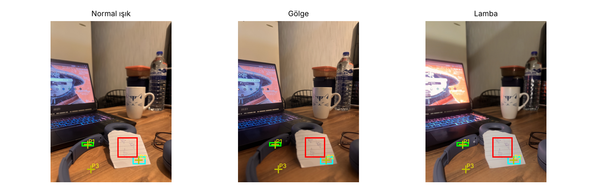
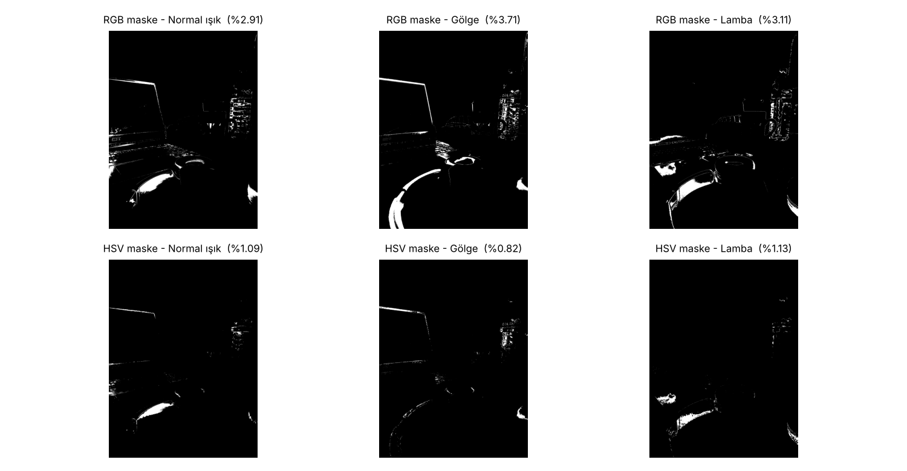
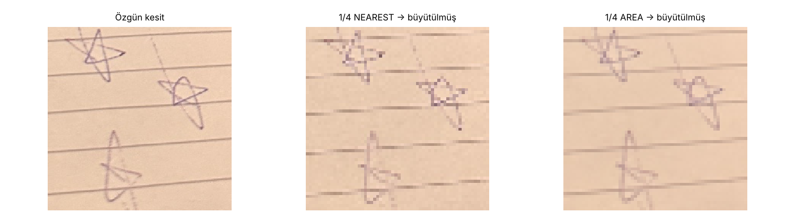

# YZM 411 Bilgisayarlı Görü – Ödevler

**Hazırlayan:** Omar Issa · **Öğrenci No:** 220212901 · **GitHub:** [DASH-10](https://github.com/DASH-10)  
OSTİM Teknik Üniversitesi · Yapay Zekâ Mühendisliği · 2026–2027 Güz

| Ödev | Konu | Rapor | Teslim paketi |
|---|---|---|---|
| Ödev 1 | Renk, Aydınlatma ve Örnekleme | [rapor.pdf](Odev1/rapor.pdf) | [YZM411_Odev1_220212901.zip](Odev1/YZM411_Odev1_220212901.zip) |

---

## Ödev 1 – Renk, Aydınlatma ve Örnekleme

Aynı masaüstü sahnesi, sabit kamerayla üç farklı ışıkta (normal, gölge, lamba) çekildi ve dört deney uygulandı:

| Deney | Ne ölçüldü | Ana bulgu |
|---|---|---|
| 4 – Sayısal yapı | Aynı fiziksel noktanın üç fotoğraftaki RGB değeri | Nesne değişmediği hâlde piksel değerleri ışıkla değişti; lamba oda ışığından daha soğuktu (B kanalı en çok arttı). |
| 5 – Sabit RGB/HSV eşikleri | Normal fotoğraftan dondurulan eşiklerle 6 maske | Gölgede nesne iki eşikle de kayboldu (ROI içi %0) ama RGB maske alanı arttı → alan oranı doğruluk değildir. Lambada HSV, RGB'den kötü çıktı (az doygun nesnede ton kararsız). |
| 6 – Parlaklık ve gama | +40 parlaklık, γ=0,5, γ=2,0 | Ortalama 108,7 → 148,2; kırpma etkisi küçük (255'teki piksel %0,02 → %3,7). |
| 7 – Küçültme | 1/4 NEAREST ve AREA | NEAREST çizgileri kesik/basamaklı yaptı ve sahte keskinlik üretti; AREA soluk ama sürekli bıraktı. |

<p align="center">
  <br>
  <br>
  
</p>

### Klasör yapısı
```
Odev1/
├── hw1.py                 # Deney 4–7 (giriş dosyaları, sürümler, parametreler results.json'a yazılır)
├── build_report.py        # results + tahminler → rapor.pdf (≤ 2 sayfa)
├── pack.py                # teslim ZIP'i
├── config.json            # ROI'ler, ölçüm noktaları, eşik yüzdelikleri
├── predictions.json       # deneylerden ÖNCE yazılan tahminler + yanıtlar
├── kaynak_beyani.md       # kaynak ve yapay zekâ beyanı
├── data/                  # normal.jpg, golge.jpg, lamba.jpg (özgün çekimler)
├── results/               # results.csv, results.json, fig1–fig4
├── rapor.pdf
└── YZM411_Odev1_220212901.zip
```

### Yeniden çalıştırma
```bash
pip install numpy opencv-python pandas matplotlib reportlab pypdf
cd Odev1
python hw1.py            # Deney 4–7 → results/
python build_report.py   # rapor.pdf
python pack.py           # YZM411_Odev1_220212901.zip
```
`python hw1.py --init` yeni fotoğraflar için config/tahmin şablonu ve ROI önizlemesi üretir.

### Notlar
- Telefon son çekimde ~27 px kaydığı için gölge/lamba fotoğrafları normal fotoğrafa ötelemeyle hizalandı (kaymalar `results.json` içinde).
- Çekim düzeneği: iPhone 14 Pro, gölge için şemsiye, lamba çekimi için zayıf beyaz lamba; sahnede kulaklık, kupa ve çizgili kâğıt.
- Otomatik pozlama ve beyaz dengesi kilitli değildi; farkın bir kısmı kameradan kaynaklanabilir.
- **Yapay zekâ beyanı:** Claude (Anthropic) kod, ROI seçimi, ölçüm öncesi tahmin taslağı ve rapor metni için kullanıldı. Ayrıntı: [kaynak_beyani.md](Odev1/kaynak_beyani.md).
